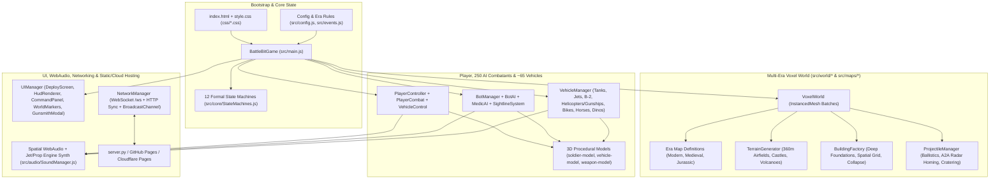

# 🏗️ BLOCKFARE — System Architecture (`ARCHITECTURE.md`)

Live WebGL Deployment: **[https://blockbuilderb.github.io/blockfare/](https://blockbuilderb.github.io/blockfare/)**  
Repository: **[https://github.com/blockbuilderb/blockfare](https://github.com/blockbuilderb/blockfare)**

---

## 1. High-Level Architecture

**BLOCKFARE** is engineered as a zero-bundler, native browser ES-module 3D tactical sandbox powered by **Three.js** (`vendor/three.module.js`) and an optional zero-dependency multi-threaded Python WebSocket + HTTP relay server (`server.py`).



---

## 2. Directory Layout

```text
blockfare/
├── index.html                        # Main Menu (Era Selector), Six-Pack Aircraft HUD, Tank FCS & DOM modals
├── style.css                         # CSS barrel importing modular css/*.css stylesheets
├── server.py                         # Zero-dependency Python HTTP + WebSocket (/ws) + Multiplayer Room server
├── _headers                          # Cloudflare Pages caching & MIME headers
├── .nojekyll                         # GitHub Pages static bypass marker
├── .github/workflows/deploy-pages.yml# Automated GitHub Pages CI/CD pipeline
│
├── src/
│   ├── main.js                       # BattleBitGame 60Hz loop, Era switching (switchEra), 800-ticket AAS economy
│   ├── config.js                     # Tuning constants, class traits, projectile ballistics & era role filters
│   ├── events.js                     # Decoupled pub/sub event bus
│   ├── vehicles.js                   # VehicleManager: tank directional armor/ERA, bank-to-turn flight, trampling
│   ├── network.js                    # Auto-detects static CDN vs. live server.py WebSocket/HTTP multiplayer
│   ├── telemetry.js                  # Diagnostic battle logger (auto-disables network POST on static hosts)
│   ├── core/
│   │   └── StateMachines.js          # 12 deterministic FSM families (Aircraft, Parachute, Medic, Lock-On, etc.)
│   ├── assets/
│   │   ├── vehicle-defs.js           # Data-driven catalog of Tanks, Jets, B-2 Spirit, FOB Bikes, Horses & Dinos
│   │   ├── weapon-defs.js            # Modern firearms, Medieval Zweihänders/Shields/Bows & Jurassic weapons
│   │   ├── attachment-defs.js        # Gunsmith optics, suppressors, grips, magazines & armor plates
│   │   ├── gunsmith-svg.js           # Vector weapon & skin silhouettes for Armory & CS2 Case Roulette
│   │   ├── textures.js               # Procedural canvas textures
│   │   └── voxel-materials.js        # Instanced voxel material definitions
│   ├── models/
│   │   ├── soldier-model.js          # Articulated 3D soldiers, knights, shields & dinosaur rigs
│   │   ├── vehicle-model.js          # 3D Tanks, F-15/Su-57, A-10, AC-130, B-2 Spirit, Wright Flyer, Bikes & Horses
│   │   ├── weapon-model.js           # 1st/3rd-person weapons, attachments & Zweihänder rigs
│   │   └── prop-models.js            # Radar towers & battlefield props
│   ├── world/
│   │   ├── VoxelWorld.js             # InstancedMesh voxel engine, vertex AO shading & 3D raycasting
│   │   ├── TerrainGenerator.js       # Heightmaps, 360m runways + side aprons, castles & Jurassic paddocks
│   │   ├── BuildingFactory.js        # Terrain-adaptive deep foundations, 2D spatial hash & building repair
│   │   ├── ProjectileManager.js      # Shells, rockets, low-altitude radar lock evasion & BFS structural collapse
│   │   ├── ConquestSystem.js         # 5-flag Conquest capture rules & 3D banners
│   │   └── WeatherSystem.js          # Day/Sunset/Night presets & dynamic weather
│   ├── bots/
│   │   ├── BotManager.js             # 250-bot lifecycle, 5 squads/team, Garrison Doctrine & War Horn orders
│   │   ├── BotAI.js                  # Throttled LOS/armor scans, bridge/castle gate routing & LOD animation
│   │   ├── MedicAI.js                # 4-stage Medic rescue FSM (ASSESS_THREAT -> APPROACH -> DRAG -> REVIVE)
│   │   └── SightlineSystem.js        # Cached multi-ray Vision Tube & smoke occlusion checks
│   ├── player/
│   │   ├── PlayerController.js       # Input, mass-inertia movement, parachute & interaction
│   │   ├── PlayerCombat.js           # Ballistics, directional melee/shield parry, Stinger lock & Tarkov reloads
│   │   ├── VehicleControl.js         # Aircraft aerodynamics, collision avoidance, flares & tank FCS
│   │   ├── CommanderAbilities.js     # UAV, Airstrikes, Rally Points & Insertion Beacons
│   │   ├── FortificationBuilder.js   # Field fortifications & paid squad emplacements
│   │   └── GunsmithState.js          # Persistent vault cash, backpack loot & weapon unlocks
│   ├── audio/
│   │   ├── SoundManager.js           # Spatial WebAudio mixer, jet/turboprop engine synth, war horns & sword clashes
│   │   └── audio-pack.js             # Weapon & ordnance sample profiles
│   └── ui/
│       ├── UIManager.js              # Cached DOM element registry & UI subsystem composition
│       ├── DeployScreen.js           # Era switcher, class/squad selector & interactive 2D deployment map
│       ├── HudRenderer.js            # Six-Pack Aircraft HUD, directional tank armor SVG & reload visualizer
│       ├── CommandPanel.js           # Commander HUD buttons (Garrison ON/OFF, AI ON/OFF) & [K] Tactical Map
│       ├── WorldMarkers.js           # 20Hz pooled 3D->2D markers, EEGS gun lead pipper & radar clutter masking
│       └── GunsmithModal.js          # Gunsmith Workbench, 2D Backpack grid & animated Case Roulette
└── tests/
    └── state-machines.test.js        # 23 automated unit tests verifying all 12 FSM families
```

---

## 3. Formal Finite-State Machine Architecture (`src/core/StateMachines.js`)

All complex entity lifecycles are governed by **12 explicit, unit-tested finite-state machines** (verified via `node tests/state-machines.test.js`) to prevent overlapping boolean state bugs:

1. **`AircraftFlightFSM`**: `PARKED_RUNWAY` → `TAXI_TAKEOFF_ROLL` → `AIRBORNE_NORMAL` ↔ `AERODYNAMIC_STALL` → `SHOT_DOWN_MAYDAY` → `DESTROYED_RESPAWNING`
2. **`PlayerParachuteFSM`**: `GROUNDED` → `AIRBORNE_FREEFALL` → `CANOPY_DEPLOYED` → `CANOPY_CUT_DROP`
3. **`GroundVehicleFSM`**: `MOTOR_POOL_IDLE` ↔ `AI_PATROL_ACTIVE` ↔ `PLAYER_DRIVEN` ↔ `WHEELIE_BOOST` → `DESTROYED`
4. **`PlayerVitalityFSM` / `StanceFSM` / `WeaponFSM` / `InteractFSM`**: Enforces mutual exclusion across `ALIVE` / `DOWNED` / `DEAD`, `STAND` / `CROUCH` / `PRONE`, and `RELOADING` / `SLOW_PACKING` / `HEALING`.
5. **`NetworkTransportFSM`**: `OFFLINE_SINGLEPLAYER` ↔ `MP_WS_CONNECTED` ↔ `MP_HTTP_FALLBACK` (with automatic static-host detection on GitHub Pages / Cloudflare Pages).
6. **`MedicRescueFSM`**: `IDLE` → `ASSESS_THREAT` → `APPROACH` → `DRAG` → `REVIVE`.
7. **`CommanderUavFSM` & `CommanderAirstrikeFSM`**: Cooldown, active datalink, and 3D mesh cleanup.
8. **`VehicleSubsystemsFSM`**: Countermeasure active/cooldown cycles and coaxial thermal overheat recovery.
9. **`TargetLockScannerFSM`**: `IDLE_NO_LOCK` → `LOCKING_ACQUIRING` → `LOCKED_SOLID_TONE` → `LOST_TARGET` (with `< 28m AGL` radar ground-clutter lock breaking).
10. **`ArmoryCaseRouletteFSM`**: `CASE_IDLE` → `CASE_ROLLING_SPIN` → `CASE_REWARD_REVEALED`.
11. **`SquadDeployablesFSM`**: Lifecycle & 3D mesh disposal for Rally Points and Recon Beacons.
12. **`BaseProtectionFSM`**: `BASE_SAFE` ↔ `BASE_INTRUDER_DEFENDED` ↔ `BASE_CONTESTED_LOCKED`.
