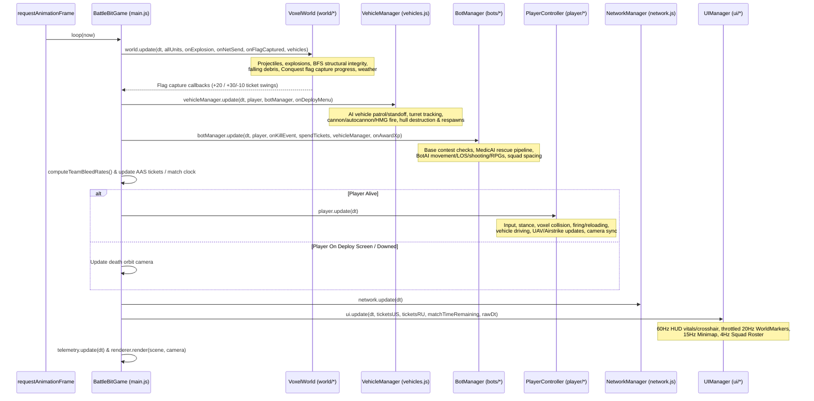
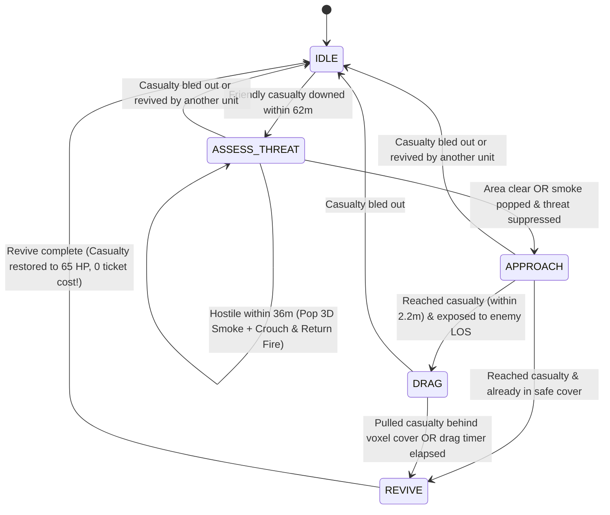

# BattleBit Clone — System Architecture (`ARCHITECTURE.md`)

This document describes the modular ES-module architecture, runtime data flow, voxel engine internals, and AI state machines of the **BattleBit Clone** combined-arms tactical FPS.

---

## 1. High-Level System Architecture

```mermaid
flowchart TD
    subgraph Entry["Application Bootstrap & Orchestrator"]
        HTML["index.html + style.css (css/*.css)"]
        MAIN["BattleBitGame (src/main.js)"]
        CFG["Central Config & Data (src/config.js, src/vehicle-defs.js, src/events.js)"]
        POOL["Object & Vector Pooling (src/utils/VectorPool.js)"]
    end

    subgraph WorldEngine["Voxel World & Physics (src/world/*)"]
        VW["VoxelWorld (src/world/VoxelWorld.js)"]
        TG["TerrainGenerator (src/world/TerrainGenerator.js)"]
        BF["BuildingFactory (src/world/BuildingFactory.js)"]
        CS["ConquestSystem (src/world/ConquestSystem.js)"]
        PM["ProjectileManager (src/world/ProjectileManager.js)"]
        WS["WeatherSystem (src/world/WeatherSystem.js)"]
    end

    subgraph CombatAgents["Player, 80 AI Bots & 12 Armored Vehicles"]
        PC["PlayerController (src/player/PlayerController.js)"]
        PMOD["Player Submodules (PlayerCombat, VehicleControl, CommanderAbilities, FortificationBuilder, GunsmithState)"]
        BM["BotManager (src/bots/BotManager.js)"]
        BMOD["Bot Submodules (BotAI, MedicAI, SightlineSystem, SoldierMeshFactory)"]
        VM["VehicleManager (src/vehicles.js)"]
        WPN["Weapon & Armory Catalog (src/weapons.js, src/textures.js)"]
    end

    subgraph Presentation["UI, Audio, Network & Telemetry"]
        UI["UIManager (src/ui/UIManager.js)"]
        UIMOD["UI Submodules (DeployScreen, HudRenderer, Scoreboard, MinimapRenderer, CommandPanel, WorldMarkers, GunsmithModal, VictoryScreen, DamageIndicators)"]
        AUD["HDR WebAudio Engine (src/audio.js, src/audio-pack.js)"]
        NET["NetworkManager (src/network.js)"]
        TEL["TelemetryLogger (src/telemetry.js)"]
        SRV["Python HTTP + WebSocket Server (server.py)"]
    end

    HTML --> MAIN
    CFG --> MAIN
    POOL --> BM

    MAIN --> VW
    VW --> TG
    VW --> BF
    VW --> CS
    VW --> PM
    VW --> WS

    MAIN --> VM
    MAIN --> BM
    BM --> BMOD
    MAIN --> PC
    PC --> PMOD
    PC --> WPN

    MAIN --> UI
    UI --> UIMOD
    MAIN --> NET
    MAIN --> TEL
    PC --> AUD
    BM --> AUD
    VM --> AUD
    NET <--> SRV
    TEL --> SRV
```



---

## 2. Directory & Module Structure

The codebase uses native browser ES Modules (`?v=35` cache-busted imports) with zero build/bundler step required. Barrel files (`src/bots.js`, `src/player.js`, `src/world.js`, `src/ui.js`, and `style.css`) preserve clean top-level imports while delegating implementation to focused domain submodules.

```text
battlebit-clone/
├── index.html                        # Main DOM structure, HUD overlays, modals, and ES module entry
├── style.css                         # CSS barrel file (@import rules preserving cascade order)
├── server.py                         # Zero-dependency Python HTTP + WebSocket (/ws) + Telemetry server
├── README.md                         # Project overview & quick start
├── ARCHITECTURE.md                   # System architecture & technical reference
├── CONTROLS.md                       # Complete keybind reference table
│
├── css/                              # Modular UI Stylesheets (imported by style.css)
│   ├── base.css                      # Reset, typography, variables, shared utility classes
│   ├── deploy.css                    # Deploy screen, class/squad/spawn selectors, 2D deploy map
│   ├── hud.css                       # Crosshair, vitals, ammo/magazine bars, compass, ticket bar, NVG
│   ├── scoreboard.css                # [TAB] 80-soldier & 10-squad live scoreboard
│   ├── minimap.css                   # Rotating tactical minimap & objective badges
│   ├── command.css                   # [K] Tactical Command Map modal & [Y] Radial Commo Rose
│   ├── gunsmith.css                  # [I] Gunsmith Armory modal & attachment cards
│   ├── markers.css                   # 3D world-space objective, squad, medic & UAV markers
│   └── victory.css                   # End-of-round victory screen, MVP cards & ticket breakdown
│
├── src/
│   ├── main.js                       # BattleBitGame orchestrator, 60Hz loop, AAS ticket economy
│   ├── config.js                     # Centralized tuning constants (PLAYER, COMBAT, BOT, VEHICLES, etc.)
│   ├── vehicle-defs.js               # Data-driven VEHICLE_DEFS array for all 12 US/RU vehicles
│   ├── events.js                     # Lightweight pub/sub event bus & cross-subsystem event helpers
│   ├── vehicles.js                   # VehicleManager: 3D voxel tank/APC/car meshes, AI patrol & turrets
│   ├── weapons.js                    # WEAPON_DEFS, CLASS_LOADOUTS, ATTACHMENT_CATALOG & 3D viewmodels
│   ├── textures.js                   # Procedural canvas textures for optics, reticles & surfaces
│   ├── audio.js                      # WebAudio synthesizer + sample playback, 3D spatial attenuation
│   ├── audio-pack.js                 # External WAV/OGG sample loader & manifest manager
│   ├── network.js                    # WebSocket (/ws) + BroadcastChannel room/voxel/player sync
│   ├── telemetry.js                  # Live battle telemetry aggregation, [F3] feed & /api/telemetry POST
│   │
│   ├── utils/
│   │   └── VectorPool.js             # Pre-allocated THREE.Vector3 ring buffer (tmpVec3, tmpVec3Copy)
│   │
│   ├── bots/
│   │   ├── BotManager.js             # SQUAD_DEFS, 80-bot lifecycle, orders, comms & damage routing
│   │   ├── BotAI.js                  # Per-frame combat targeting, movement, RPG anti-armor & boarding
│   │   ├── MedicAI.js                # 4-stage Medic rescue state machine (ASSESS_THREAT..REVIVE)
│   │   ├── SightlineSystem.js        # Voxel-aware line-of-sight (LOS) raycasting & FOV cone checks
│   │   └── SoldierMeshFactory.js     # Articulated 3D soldier meshes with shared material/geometry cache
│   ├── bots.js                       # Barrel re-exporting BotManager, createSoldierMesh, SQUAD_DEFS
│   │
│   ├── player/
│   │   ├── PlayerController.js       # Core player state, keyboard/mouse input, physics & camera update
│   │   ├── PlayerCombat.js           # Firing, ballistics, mag rotation/packing, C4, damage & revives
│   │   ├── VehicleControl.js         # [E] Enter/exit vehicle, turret ballistics & ally drag toggle
│   │   ├── CommanderAbilities.js     # [U] UAV drone, [J] Airstrike patterns, [5] Rally, [6] Beacon, Ping
│   │   ├── FortificationBuilder.js   # [F] Point defense / chest-wall builder & [4] Sledgehammer logic
│   │   └── GunsmithState.js          # Combat Cash ($) economy & persistent attachment upgrades
│   ├── player.js                     # Barrel re-exporting PlayerController
│   │
│   ├── world/
│   │   ├── VoxelWorld.js             # InstancedMesh batching, spatial hash grid, raycast & AABB collision
│   │   ├── TerrainGenerator.js       # Valley heightmap, river, bridges, trees, cover & motor pools
│   │   ├── BuildingFactory.js        # Multi-story Garrison Compounds (A–E) & buildable Point Defenses
│   │   ├── ConquestSystem.js         # 5 Conquest Flags (A–E) capture math & 3D animated banners
│   │   ├── ProjectileManager.js      # Ballistic projectiles, explosions, BFS structural collapse & debris
│   │   └── WeatherSystem.js          # Dynamic weather transitions & DAY/SUNSET/NIGHT atmosphere modes
│   ├── world.js                      # Barrel re-exporting VoxelWorld and VOXEL_SIZE
│   │
│   └── ui/
│       ├── UIManager.js              # Core UI controller, DOM cache (this._domCache) & update loop
│       ├── DeployScreen.js           # Interactive 2D deployment map, class/squad/rank/mode selection
│       ├── HudRenderer.js            # Vitals, weapon/magazine HUD, compass, ticket bleed & FPS pill
│       ├── Scoreboard.js             # [TAB] Team & squad leaderboards + war-crime / vehicle stats
│       ├── MinimapRenderer.js        # Cached-context 2D rotating minimap with UAV & order overlays
│       ├── CommandPanel.js           # [K] Tactical Command Map modal & [Y] Commo Rose wheel
│       ├── WorldMarkers.js           # Pooled 20Hz 3D->2D screen-space projection for flags & units
│       ├── GunsmithModal.js          # [I] Armory upgrade shop UI
│       ├── VictoryScreen.js          # Post-match summary & MVP awards
│       └── DamageIndicators.js       # 360° directional incoming fire arcs & hitmarkers
├── vendor/
│   └── three.module.js               # Vendored Three.js ES module
└── assets/audio/                     # Weapon, armor cannon, reload & explosion audio samples
```

---

## 3. Core Game Loop & Subsystem Data Flow

`BattleBitGame.loop(now)` in `src/main.js` runs via `requestAnimationFrame`, computing a clamped delta time `dt = Math.min(0.05, rawDt)` and driving subsystems in a deterministic order each frame:



### Key Performance & Memory Design Patterns
1. **Composition via Prototype Mixins**: Large controllers (`PlayerController`, `VoxelWorld`, `UIManager`, `BotManager`) split their domain logic across focused files and compose methods onto the class prototype (`Object.assign(Class.prototype, ...)`), preserving 100% backward compatibility with zero wrapper indirection.
2. **Object & Vector Pooling (`src/utils/VectorPool.js`)**: Hot per-frame AI and physics loops use `tmpVec3()` and `tmpVec3Copy()` from a pre-allocated ring buffer instead of allocating thousands of short-lived `new THREE.Vector3()` instances per frame.
3. **Shared Bot Materials & Geometries (`src/bots/SoldierMeshFactory.js`)**: All 80 AI soldiers share cached `THREE.BoxGeometry` and team/role `THREE.MeshLambertMaterial` instances (cloning only the animated per-bot `muzzleFlash` material), drastically cutting WebGL shader/material state switches.
4. **Throttled UI & DOM Caching (`src/ui/*`)**:
   - `UIManager` caches DOM element references in `this._domCache` (`this.el(id)`) to avoid repeated `document.getElementById` lookups at 60Hz.
   - `WorldMarkers` updates at `20Hz` and reuses pooled DOM nodes when marker counts are unchanged.
   - `MinimapRenderer` updates at `15Hz` using cached 2D canvas contexts.
   - Squad roster and telemetry panels update at `4Hz`.

---

## 4. Voxel Engine, Instanced Batching & Structural Integrity

### Instanced Voxel Batching (`src/world/VoxelWorld.js`)
- **Grid Scale**: Each voxel is `VOXEL_SIZE = 1.5m` cubed.
- **Material Batches**: Voxels are grouped by material type (`brick`, `concrete`, `darkConcrete`, `sandbag`, `wood`, `container`, `prop`) into `THREE.InstancedMesh` batches.
- **Spatial Hash Lookup**: Active voxels are indexed in `this.voxels` (`Map<"gx,gy,gz", VoxelData>`) with O(1) coordinate lookup for raycasting (`raycastVoxel`), AABB movement collision (`collideBox`), and blast damage.
- **Zero-Allocation Damage Shading**: When a voxel takes partial damage (`damageVoxel`), a pre-allocated reusable `THREE.Color` darkens the instance color via `InstancedMesh.setColorAt(instanceId, tempColor)` without heap allocations. When a voxel is destroyed (`destroyVoxel`), its instance matrix is zero-scaled or swapped with the last active instance in the batch.

### Structural Integrity & Progressive Building Collapse (`src/world/ProjectileManager.js`)
When an explosion (`explodeAt`) or sledgehammer destroys voxels:
1. **Local Cantilever Span Check (`checkStructuralIntegrity`)**:
   - Neighboring voxels around the blast crater run a bounded Breadth-First Search (BFS) up to `TERRAIN.MAX_SPAN = 3` blocks (`4.5m`) looking for a downward support path to terrain (`gy <= baseGy`) or a vertical pillar.
   - Any voxel lacking support within `MAX_SPAN` detaches and spawns a physical falling block (`spawnFallingBlock`) that crushes units underneath.
2. **Cluster Building Collapse (`checkBuildingClusterCollapse` & `triggerBuildingCollapse`)**:
   - Each multi-story building tracks its initial vs. remaining structural voxel count.
   - Once remaining structural voxels drop below `TERRAIN.BUILDING_COLLAPSE_THRESHOLD` (`<= 45%` remaining, i.e., `>55%` destroyed), the entire remaining superstructure collapses into a cascade of falling rubble blocks and dust clouds.

---

## 5. AI State Machines (`src/bots/*`)

### A. Combat & Objective AI (`src/bots/BotAI.js`)
Each of the 80 bots evaluates a prioritized behavioral hierarchy every frame:
1. **Vehicle Crew / Motor Pool Boarding**:
   - If already driving a vehicle (`bot.drivingVehicle`), the vehicle's AI controller (`src/vehicles.js`) handles pathing and turret engagement.
   - When spawning at or near Main Base with unoccupied motor pool vehicles, eligible AI soldiers seek and board empty Tanks, APCs, or Armored Cars.
2. **Target Acquisition & Sightline Verification (`src/bots/SightlineSystem.js`)**:
   - Bots scan for hostile infantry and vehicles within engagement range (`115m` infantry, `135m` RPG anti-armor), filtering by FOV cone and voxel raycast line-of-sight (`hasClearSightline`) plus active 3D smoke screen occlusion (`smokeClouds`).
   - If the Commander's **MQ-9 UAV Datalink (`[U]`)** is active, revealed enemies are shared across the team datalink.
3. **Weapon & Anti-Armor Selection**:
   - `ENGINEER` bots automatically switch to their **RPG-7** when an enemy Tank, APC, or Humvee/Tigr is in sight (`<= 135m`) and fire ballistic HEAT rockets.
   - Infantry engage with class-appropriate burst cadence, aiming lead, and crouch/strafe micro-maneuvers.
4. **Navigation & Obstacle Vaulting**:
   - Bots steer toward their squad's active Strategic Order (`OBJECTIVE A–E`, `FOLLOW`, `HOLD`, or `AUTO` frontline capture), navigating bridges, doorways, and vaulting low obstacles.

### B. Tactical Medic Rescue State Machine (`src/bots/MedicAI.js`)
When a friendly soldier (AI or Player) is downed (`bleedOutTimer = 22s`), nearby `MEDIC` bots enter a dedicated 4-state rescue machine:



### C. Squad Formation Spacing (`STAY_CLOSE` vs. `FAN_OUT`)
Controlled via **`Numpad -`** (`STAY_CLOSE`) and **`Numpad +`** (`FAN_OUT`) in `BotManager.computeBotSpacingOffsets()` and `VehicleManager`:

| Parameter | `STAY_CLOSE` (`Numpad -`) | `FAN_OUT` (`Numpad +`) | Tactical Purpose |
| :--- | :---: | :---: | :--- |
| **Squad Leader Follow Radius** | `2.0m – 4.5m` | `9.0m – 18.0m` | Tight urban stack vs. artillery/airstrike dispersion |
| **Objective Hold Ring** | `3.5m – 7.5m` | `12.0m – 25.0m` | Concentrated room defense vs. wide perimeter screen |
| **Peer Bot Separation** | `1.8m` | `7.5m` | Prevents bunching under HE shells or C4 |
| **Friendly Tank Standoff** | `42m` | `105m` | Close infantry-tank push vs. hull-down overwatch |
| **Friendly APC / IFV Standoff** | `36m` | `100m` | Close fire support vs. standoff autocannon screen |
| **Friendly Humvee / Tigr Standoff** | `32m` | `95m` | Point escort vs. wide flank security |
